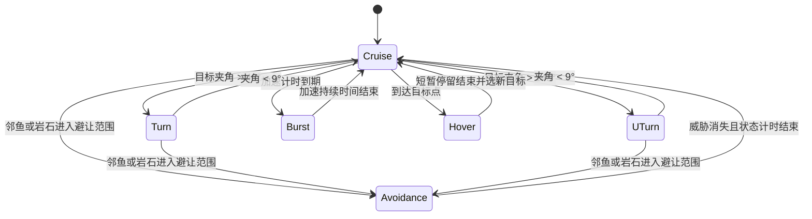

# 鱼类行为设计说明

版本：2026-11-18  
适用范围：首个 Unity 单缸垂直切片。本文区分**当前已实现**与**设计目标/待实现**，避免把计划中的生态行为误认为已经进入游戏。

本页鱼群参数已按 2026-11-18 Play Mode 原型更新；实时投喂、简化水质和昼夜反馈属于可观察的 Demo 代理，不代表完整生态模拟。

## 1. 目标与原则

鱼的行为要帮助玩家读懂鱼种差异和鱼缸状态，同时保持鱼缸适合观赏：

- 鱼持续、平滑地游动，不瞬间转向，不长期停在一处。
- 近距离避碰优先于群体跟随，鱼不互相穿插，也不被挤飞。
- 群体有共同活动范围，但单鱼会有轻微偏离、转向和速度差异。
- 物种差异首先体现在活动水层、巡游速度、身体尺寸和后续可观察意图；不让所有鱼套用完全相同的活动方式。
- 水温、pH、压力、健康、饥饿等生态状态最终应能影响行为，并让玩家能理解原因。

## 2. 行为分层

行为采用三个层次，避免把行为意图和运动状态混成一个互斥状态机。

| 层 | 负责内容 | 当前实现 |
|---|---|---|
| 行为意图 | 漫游、群体跟随、觅食、进食、休息、繁育互动、受惊逃避、水质不适反应 | 漫游/群游、追逐并摄取投下的鱼粮已实现；演示水质压力会减慢鱼速，完整状态系统未实现 |
| 移动状态 | 巡游、转向、掉头、短促加速、悬停、避让 | 已实现六种状态 |
| 身体动画 | 躯干摆波、尾鳍/尾柄摆动、胸鳍与中线鳍摆动、轻微浮动 | 已实现；幅度随速度变化 |

## 3. 当前移动状态

状态含义和当前触发：

| 状态 | 当前行为 |
|---|---|
| Cruise 巡游 | 朝个体目标点连续前进；受群体方向和避让向量轻微修正 |
| Turn 转向 | 目标方向偏差超过 52° 时减速，以有限角速度转弯；夹角低于 15° 后回到巡游 |
| UTurn 掉头 | 目标在身后、偏差超过 150° 时进入；降低速度并连续转向，不瞬间反向 |
| Burst 短促加速 | 首次在随机 6–12 秒后触发，之后每隔 7–14 秒可触发；每次持续 0.75–1.1 秒 |
| Hover 悬停 | 到目标点 0.28 米内后按鱼种停留：孔雀鱼 0.14–0.32 秒、霓虹灯鱼 0.22–0.42 秒、熊猫鼠 0.55–0.95 秒；仍保持约半速漂动 |
| Avoidance 避让 | 邻鱼过近或接近石组时优先改变方向；触发后至少保持 0.22 秒，避免在避让边界反复进出 |

避让是当前移动状态中的优先修正。避让/群游向量每帧都可能轻微变化，因此航向目标还会再平滑：普通巡游目标方向最多变化 68°/秒，检测到避让时可提高到 210°/秒。这样在平稳游动时减少抖动，同时保留对障碍物的快速响应。当前代码还没有独立的“受惊逃逸”意图；群体聚合、转向和加速不能代替受惊行为。

## 4. 群体与个体目标

### 群体活动中心

每个物种有一个缓慢移动的群体中心。它在初始活动区域周围随机选点，每 6–11 秒重新选目标，鱼群跟随移动中心，而不是绕固定点打转。

| 物种 | 初始中心（Unity 坐标） | 活动高度 | 群中心速度 |
|---|---|---|---:|
| 孔雀鱼 | (-2.7, 1.15, -0.3) | 上/中层；群中心目标 y=0.55 至 2.0 | 0.78 m/s |
| 霓虹灯鱼 | (2.4, 0.05, 0.35) | 中层；群中心目标 y=-0.45 至 0.9 | 0.56 m/s |
| 熊猫鼠 | (0.2, -2.2, 0.2) | 贴近底层；目标 y=-2.6 至 -2.05，鱼体最低约 -2.58 | 0.38 m/s |

每条鱼会在群中心附近选自己的航点，并把当前航向作为前进偏置，减少完全随机的反向折返。孔雀鱼偏移半径约 1.7 米，霓虹灯鱼约 1.05 米，熊猫鼠约 0.72 米；航点重选间隔分别约 4.2–7、5–7.5、2.7–4.6 秒。

个体会以 0.14 米/秒（孔雀鱼和霓虹灯鱼）或 0.07 米/秒（熊猫鼠）的速度缓慢追踪目标高度，水平转向仍在水平面内完成。

### 群游规则

- 每条鱼只参考同种鱼中最近的三条；搜索半径孔雀鱼 5.2 米、霓虹灯鱼 3.6 米、熊猫鼠 3.4 米。
- 群体方向对齐/凝聚权重分别为：孔雀鱼 0.16/0.14（松散），霓虹灯鱼 0.58/0.55（更紧密），熊猫鼠 0.30/0.34（底层小群）。
- 与群体中心相距不足 1.2 米时关闭额外凝聚力，避免所有鱼挤成一点。
- 不同鱼种不互相吸引，但都参与近距离分离，防止穿模。

当前是轻量群游，不是严格同步编队；三种鱼共享规则结构，但各自使用不同的搜索半径、凝聚/对齐权重、活动层和个体目标范围。

## 5. 避碰、避障和活动边界

- **鱼对鱼避让**：距离小于两条鱼的碰撞半径之和加 0.18 米时，产生分离转向力；垂直方向的影响减弱。合计避让向量平方强度超过 0.035 时进入避让保持期。
- **软间距修正**：若仍有轻微重叠，以速度受限的位置修正推开，单帧最多修正 0.32 米/秒，避免瞬移和抖动。
- **假山避让**：将各块石头的包围盒作为障碍；离障碍小于鱼体半径加 0.38 米时产生避让力。
- **缸壁边界**：代理根节点限制在 x=[-4.65, 4.65]、y=[-2.7, 2.1]、z=[-1.35, 1.35]；鱼体和尾鳍另有模型余量。

岩石避让与鱼群分离分别按 3.0 和 2.35 的当前系数叠加到目标方向上；基础航点方向和群体方向也会参与合成。石组尺寸变化后，避让包围盒必须与 Unity 内模型的实际位置/比例同步。

## 6. 速度、转弯和身体动画

| 物种 | 巡游速度 | 碰撞半径 | 基础摆动频率 |
|---|---:|---:|---:|
| 孔雀鱼 | 0.74 m/s，个体 ±10% | 0.46 m | 8.6–10.1 Hz |
| 霓虹灯鱼 | 0.64 m/s，个体 ±10% | 0.44 m | 7.2–8.4 Hz |
| 熊猫鼠 | 0.38 m/s，个体 ±10% | 0.48 m | 5.4–6.5 Hz |

状态速度倍率：避让 0.82、加速 1.7、掉头 0.42、转向 0.62、悬停 0.48、巡游 1.0。转弯角速度为掉头 44°/秒、普通转向 64°/秒、其他状态 88°/秒；转弯时速度向量比身体朝向更快地跟随，减少侧滑感。

演示水质压力系数在氨氮约 0.12–0.42 mg/L 之间渐进增加；最高将鱼速降至基础目标的 68%。换水按钮会降低简化水质值。该数值仅为可观察的原型反馈，不能当作正式养护阈值。

身体表现：

- 躯干后段使用延迟侧向波动，越靠近尾部振幅越大；当前振幅因物种在 0.038–0.055 米之间。
- 尾柄/尾鳍摆幅约 11°，胸鳍约 8°，背鳍和臀鳍约 3°；频率与游速联动。
- 鱼体轻微上下浮动：普通鱼约 0.02 米，熊猫鼠约 0.008 米。
- 普通游动保持身体直立；转弯时有轻微侧倾，最大约 8°。

以上是当前代理的观赏动画参数，不表示真实生物学测量值，需以运行画面继续校准。

## 7. 当前物种差异和边界

当前行为差异包括：活动水层、群体中心速度、个体巡游速度、碰撞半径、摆动频率/幅度、目标范围、群游松紧和停留时长。三种鱼仍共享移动状态机。

### 投喂与水质反馈原型

- Game View 点击缸内会投下 8 粒约 2.4–3.6 厘米的鱼粮；鱼粮缓慢下沉并轻微漂移。单粒只被一条鱼认领，鱼追到近处摄取后消失。追食时会加快转向、加速并抬头/低头跟随目标；HUD 显示剩余鱼粮、追食和摄食数量。
- 一次投喂分成 8 粒，散布在约 2.5 米直径范围内并尽量拉开相邻颗粒；孔雀鱼/霓虹灯鱼约在 3.7 米内响应，熊猫鼠约在 2.6 米内优先找沉降食物。摄食后做约 0.7–1.05 米的短离开弧线，停约 1.0–1.45 秒后再找附近剩余颗粒，避免全部鱼挤成一排。
- 未吃完而过期的鱼粮会增加演示用氨氮/硝酸盐负担；水质状态变差时鱼速降低。HUD 可执行 30% 换水以降低这些值。
- Demo 每 8 秒推进约 1 个缸内小时；顶灯、补光、水体背景色和水温显示随昼夜变化。
- 这是展示交互闭环的简化模型，不包含食量/饱腹度、过滤介质、完整化学平衡、疾病或鱼只健康风险。

### 摄食动作参考（调研）

- 一项对成群斑马鱼摄取分散薄片食物的追踪研究观察到：鱼靠近食物时加速，摄食时急转并减速；多数三鱼/六鱼群中，同伴会在 1–4 秒内更常经过刚摄食的位置，且食物越多，这种对同伴摄食点的吸引越弱。[群体觅食研究](https://pmc.ncbi.nlm.nih.gov/articles/PMC7492088/)。斑马鱼不是本 Demo 的鱼种，这里只借用可观察的动作节奏与群体线索。
- 孔雀鱼实验在啃食藻类时记录到约每 0.55 秒连续一次的快速啄食动作；这是底物啃食实验，不能直接等同于所有干粮摄食，但支持“短促反复摄取”而非长时间停在鱼粮旁。[孔雀鱼摄食行为研究](https://central.bac-lac.gc.ca/.item?app=Library&id=TC-QMM-93942&oclc_number=670109917&op=pdf)。
- 因此 Demo 采用“靠近加速—摄食时转向减速—离开一小段—再搜寻”的可变循环；没有把每条鱼都设成完全相同的固定撤离距离/等待时间。

以下行为尚未接入，不能描述为已实现：

- 饱腹度、食物营养和长期饥饿驱动的觅食。
- 休息/睡眠意图、昼夜活动节律，以及熊猫鼠沿底床扫寻食物的鼻须动作。
- 完整水温/pH/氨氮模型、压力积累/恢复、健康变化、躲藏和进食变化；当前只有简化氨氮速度反馈。
- 受惊逃逸、鱼只之间追逐、繁育互动和幼鱼躲避捕食。
- 低氧时熊猫鼠上浮吞气。

这些意图加入后应通过优先级仲裁，而不是继续把所有行为塞进 `FishMovementState`：

**紧急避让/逃逸 > 近距离避碰 > 受惊 > 进食/繁育互动 > 群体跟随 > 自由漫游 > 短暂停留。**

## 8. 后续实现建议

1. 先观察稳定巡游与群体分布，确认三种鱼的活动层、速度和间距读起来清楚。
2. 在已实现投喂追食之外，加入不依赖水质的休息和熊猫鼠扫底觅食，验证“移动状态”和“行为意图”分层。
3. 将当前氨氮速度反馈升级为完整的饥饿、压力、健康和水质状态；轻松、标准、逼真模式按手册规则提供不同反馈。
4. 为熊猫鼠单独设计底床觅食路径，为霓虹灯鱼调高群体一致性，为孔雀鱼保留更松散的个体漫游与繁育互动。
5. 用 Game 视图近景复核鱼尾摆动、穿模、活动边界和水草遮挡后再调参数。

## 9. 请审阅的设计点

- **群体松紧**：当前霓虹灯鱼邻居搜索半径 3.6 米、孔雀鱼 5.2 米，凝聚/对齐权重按鱼种区分；后续可根据画面继续调整队形松紧。
- **熊猫鼠行为**：当前熊猫鼠在底层游动，但没有沿沙床觅食动画。建议加入鼻须扫底和短距离觅食停顿后，再决定活动范围与节奏。
- **短暂停留**：当前悬停只有 0.18–0.42 秒且仍以半速漂动。若画面需要更像活鱼，可保留短暂停顿；若需要更舒缓观赏，可把停留延长，但避免整群同时停下。
- **参数表现**：速度、半径与振幅目前是原型参数，应通过你观察 Game 画面来校准，不当作最终鱼类生物学数值。

## 10. 代码对应

- 群体中心、单鱼状态机、避碰、岩石避让、转向和身体/鳍动画：`game/fish-tank/Assets/Scripts/Demo/FishBehaviorAgent.cs`
- 物种数量、活动中心、模型加载、尺寸与躯干外观调整：`game/fish-tank/Assets/Scripts/Demo/FishTankDemoController.cs`
- 已确认的生态行为边界与三档反馈：`docs/development-handbook.md`
